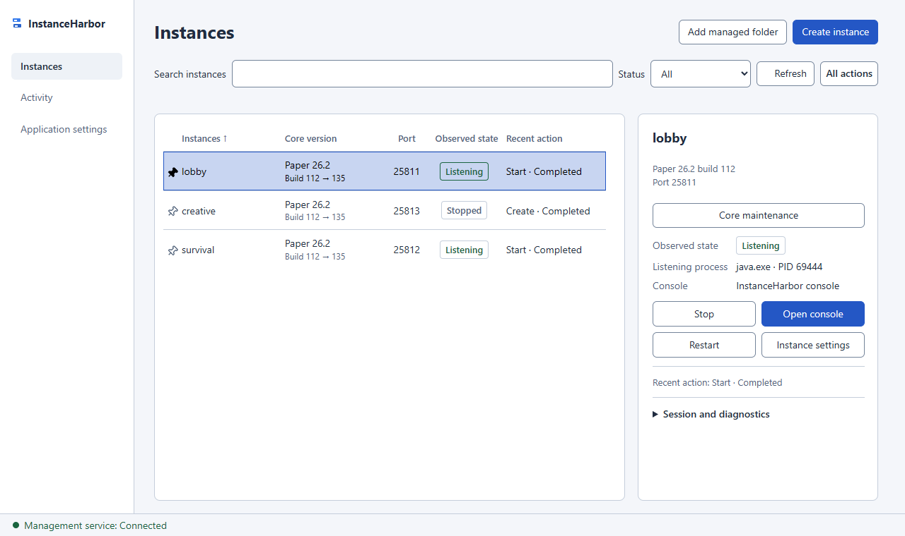

# InstanceHarbor

English | [繁體中文](README.zh-TW.md)

InstanceHarbor is a Windows desktop app and command-line tool for running Minecraft servers on your own PC. Create servers or bring in existing ones, start and stop them, type commands in a built-in console, keep their cores up to date, and edit their settings from one window. It is made for plugin developers and anyone who runs several test servers side by side.



## Features

- **Create or bring in servers.** Create a server from an official Paper or Folia build, or from your own JAR. Add a managed folder anywhere on your local drives, and InstanceHarbor finds the servers inside it.
- **Every common core.** Paper, Folia, Purpur and other Paper forks, Spigot and CraftBukkit, and the Velocity proxy, from Minecraft 1.8.8 to 26.x. The core JAR can have any file name.
- **Built-in console.** Every server runs in an InstanceHarbor console where you can type commands. Servers keep running when you close the window.
- **Start, stop and restart.** Control one server or a selection, optionally restart a server automatically after a crash, and see each step in the activity log.
- **Java picked for you.** InstanceHarbor chooses an installed Java that matches the server's Minecraft version, for example Java 8 for 1.8.8 and Java 25 for 26.x. You can also choose Java yourself.
- **Settings and game rules.** Edit `server.properties` and game rules. Changes apply live through the console, or are written into the world after a normal stop.
- **Core updates.** Check for newer builds of the same version line, optionally download them in advance, and update one server or many. Each update keeps a backup you can restore.
- **Verified cores, offline friendly.** Cores are checked by SHA-256 against the official PaperMC list. Without a network connection, or for cores PaperMC does not publish, the server still works and InstanceHarbor shows a warning.
- **Desktop integration.** A notification-area icon that shows while the background Manager runs and can quit it, and an English or Traditional Chinese interface that follows your Windows language.

## Requirements

- 64-bit Windows 10 or Windows 11.
- [Microsoft Edge WebView2 Runtime](https://developer.microsoft.com/microsoft-edge/webview2/). It is already installed on Windows 11. If it is missing, InstanceHarbor tells you when it starts.
- A Java installation that fits your servers' Minecraft versions.

## Install

Download the latest release from [GitHub Releases](https://github.com/Command1264/InstanceHarbor/releases).

Each file is built for one processor architecture: `windows-x64` for most PCs, `windows-arm64` for ARM64 PCs such as those with Snapdragon processors. Choose the one that matches your PC; in-app updates keep the architecture you installed.

- **Setup** (`InstanceHarbor-<version>-windows-<x64|arm64>-setup.exe`) installs for the current user by default, without administrator rights, and adds a Start menu entry. You can choose another folder, or install for all users of the computer (in Program Files, with administrator approval). Run a newer Setup to update; it keeps the scope and folder. Uninstalling keeps your servers and settings. The ARM64 Setup refuses to run on an x64 PC. The x64 Setup on an ARM64 PC warns that Windows would run it through emulation, which can be slower and may break some low-level Windows components, and installs only if you confirm. Running the Setup of the other architecture over an installation switches it to that architecture and keeps your data.
- **Portable ZIP** (`InstanceHarbor-<version>-windows-<x64|arm64>.zip`): extract the whole ZIP to one folder and open `InstanceHarbor.exe`. See `WINDOWS-GETTING-STARTED.txt` inside the ZIP.

Setup is not code-signed yet, so Windows SmartScreen may warn you. Choose **More info**, then **Run anyway**.

## Quick start

1. Open **InstanceHarbor** from the Start menu.
2. Add a server:
   - **Create instance**: enter a name and a port, choose an official build or a local JAR, then preview and create it.
   - **Add managed folder**: choose a folder that contains existing servers, review the list, then save.
3. Select the server and choose **Start**. When its state is **Listening**, choose **Open console** to type commands.
4. Choose **Stop** to stop the server normally, or type `stop` in the console.

Your settings and server records are kept in `%LOCALAPPDATA%\InstanceHarbor\workspaces\default`. Servers that you create are placed in the `instances` folder there; servers that you bring in stay in their own folders.

## Command line

`ihctl.exe` is installed next to `InstanceHarbor.exe` (the example uses the default folder for the current user). Every command takes the workspace folder first:

```powershell
$ihctl = "$env:LOCALAPPDATA\Programs\InstanceHarbor\ihctl.exe"
$workspace = "$env:LOCALAPPDATA\InstanceHarbor\workspaces\default"
& $ihctl $workspace list
& $ihctl $workspace status lobby
```

`& $ihctl --version` prints the version and the Git commit of the build, for example `InstanceHarbor CLI 1.0.0 (33dfd35)`. The same values, with links to this repository, are under **Application settings** → **About**.

See the [development guide](docs/development.md) for the full set of commands.

## Build from source

Prerequisites: 64-bit Windows, PowerShell 7, Node.js 24 with npm, the stable Rust toolchain for `x86_64-pc-windows-msvc` (or `aarch64-pc-windows-msvc` on an ARM64 PC), and Visual Studio Build Tools with the Windows SDK. Release builds take `-Architecture x64|arm64`; see the development guide.

```powershell
npm ci
cargo fetch --manifest-path src-tauri/Cargo.toml
./packaging/build-product.ps1 -Development
./scripts/launch-development.ps1
```

The development build uses its own data folder, `%LOCALAPPDATA%\InstanceHarbor Dev`, so it never touches the installed app's servers.

Run the tests:

```powershell
node --test src/*.test.mjs preview/*.test.mjs
npx vue-tsc --noEmit -p tsconfig.json
cargo test --manifest-path src-tauri/Cargo.toml --lib
```

Release builds need the pinned console runtime and license notices; see [Windows distribution and licenses](docs/windows-distribution-licenses.md).

## Documentation

The full documentation is in Traditional Chinese:

- [Development guide](docs/development.md): features in detail, build, test, isolated acceptance, storage locations and rollback.
- [1.1.0 release notes](docs/windows-1.1.0.md). The earlier [1.0.1 release notes](docs/windows-1.0.1.md), [1.0.0 release notes](docs/windows-1.0.0.md) and [1.0.0-rc2 pre-release notes](docs/windows-rc2.md) remain for reference.
- [Windows distribution and licenses](docs/windows-distribution-licenses.md) (English): how to build a distribution, plus the third-party notices and corresponding MPL sources.

Report problems and ideas in [GitHub Issues](https://github.com/Command1264/InstanceHarbor/issues).

## License

InstanceHarbor source is available under the [MIT License](LICENSE). Third-party components retain their own terms.

This English README is the primary version. Keep [README.zh-TW.md](README.zh-TW.md) in sync when you change it.
