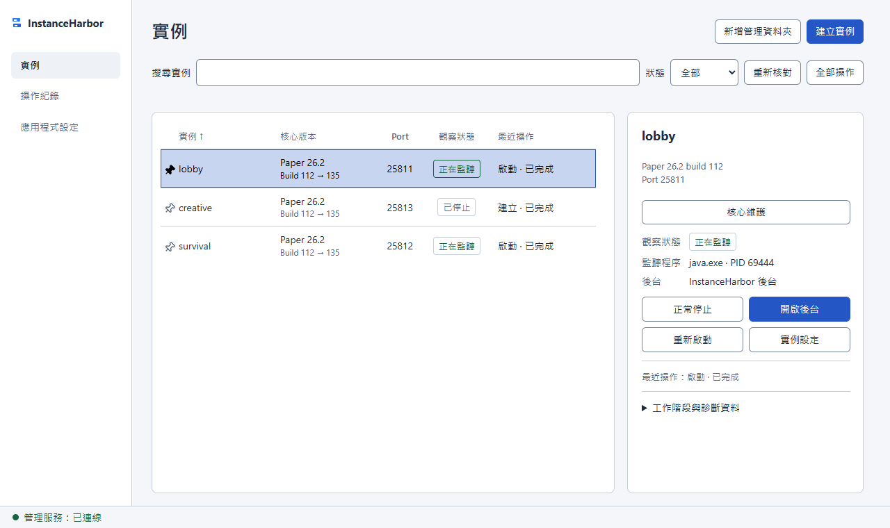

# InstanceHarbor

[English](README.md) | 繁體中文

InstanceHarbor 是在自己電腦上執行 Minecraft 伺服器的 Windows 桌面程式與命令列工具。在同一個視窗裡，可以建立伺服器或帶入既有的伺服器、啟動與停止、在內建後台輸入指令、更新核心，以及修改設定。適合插件開發者，以及需要同時執行多台測試伺服器的人。



## 功能

- **建立或帶入伺服器**：用 Paper 或 Folia 的官方版本，或自己的 JAR 建立伺服器。也可以新增本機任何位置的管理資料夾，InstanceHarbor 會找出裡面的伺服器。
- **支援常見核心**：Paper、Folia、Purpur 等 Paper 分支、Spigot 與 CraftBukkit，以及 Velocity 代理，Minecraft 版本從 1.8.8 到 26.x。核心 JAR 不限檔名。
- **內建後台**：每台伺服器都在 InstanceHarbor 的後台執行，可以直接輸入指令。關閉視窗後，伺服器仍會繼續執行。
- **啟動、停止與重新啟動**：可以操作單台或多台，可設定當機後自動重新啟動，每個步驟都記錄在操作紀錄。
- **自動選擇 Java**：依伺服器的 Minecraft 版本挑選已安裝的相容 Java，例如 1.8.8 用 Java 8、26.x 用 Java 25。也可以自己指定。
- **設定與遊戲規則**：修改 `server.properties` 與遊戲規則。變更透過後台即時套用，或在正常停止後寫入世界存檔。
- **核心更新**：檢查同版本線的新 build，可以先在背景下載，再更新單台或多台。每次更新都會保留備份，可以還原。
- **核對核心，也能離線使用**：以 SHA-256 比對 PaperMC 官方清單。沒有網路，或是 PaperMC 沒有發布的核心時，伺服器仍可使用，InstanceHarbor 會顯示警告。
- **桌面整合**：背景 Manager 執行時顯示系統匣圖示，可從圖示結束 Manager；介面依 Windows 語言顯示英文或繁體中文。

## 系統需求

- 64 位元的 Windows 10 或 Windows 11。
- [Microsoft Edge WebView2 Runtime](https://developer.microsoft.com/microsoft-edge/webview2/)。Windows 11 已內建；缺少時，InstanceHarbor 啟動時會提示。
- 符合伺服器 Minecraft 版本的 Java。

## 安裝

從 [GitHub Releases](https://github.com/Command1264/InstanceHarbor/releases) 下載最新版本。

- **Setup**（`InstanceHarbor-<版本>-windows-x64-setup.exe`）：預設為目前使用者安裝，不需要系統管理員權限，並在「開始」選單建立捷徑。也可以改選其他資料夾，或為這台電腦的所有使用者安裝（放在 Program Files，需要系統管理員確認）。要更新時，執行較新的 Setup 即可，會沿用原本的範圍與資料夾。解除安裝會保留伺服器與設定。
- **便攜版 ZIP**（`InstanceHarbor-<版本>-windows-x64.zip`）：把 ZIP 完整解壓到同一個資料夾，再開啟 `InstanceHarbor.exe`。說明請見 ZIP 內的 `WINDOWS-GETTING-STARTED.txt`。

Setup 目前尚未簽章，Windows SmartScreen 可能會顯示警告。請選「其他資訊」，再選「仍要執行」。

## 快速開始

1. 從「開始」選單開啟 **InstanceHarbor**。
2. 加入伺服器：
   - **建立實例**：輸入名稱與 Port，選擇官方版本或本機 JAR，預覽後建立。
   - **新增管理資料夾**：選擇放有既有伺服器的資料夾，確認清單後儲存。
3. 選取伺服器，按 **啟動**。狀態變成 **正在監聽** 後，按 **開啟後台** 就能輸入指令。
4. 按 **正常停止** 停止伺服器，或在後台輸入 `stop`。

設定與伺服器的登記資料放在 `%LOCALAPPDATA%\InstanceHarbor\workspaces\default`。用 InstanceHarbor 建立的伺服器放在其中的 `instances` 資料夾；帶入的伺服器則留在原本的資料夾。

## 命令列

`ihctl.exe` 安裝在 `InstanceHarbor.exe` 旁邊（範例使用目前使用者的預設資料夾）。每個指令的第一個參數都是工作區資料夾：

```powershell
$ihctl = "$env:LOCALAPPDATA\Programs\InstanceHarbor\ihctl.exe"
$workspace = "$env:LOCALAPPDATA\InstanceHarbor\workspaces\default"
& $ihctl $workspace list
& $ihctl $workspace status lobby
```

`& $ihctl --version` 會顯示版本與建置時的 Git commit，例如 `InstanceHarbor CLI 1.0.0 (33dfd35)`。「應用程式設定」→「關於」也顯示同樣的資訊，並附上本儲存庫的連結。

完整的指令請見[開發指南](docs/development.md)。

## 從原始碼建置

需要：64 位元 Windows、PowerShell 7、Node.js 24 與 npm、`x86_64-pc-windows-msvc` 的 Rust stable 工具鏈，以及含 Windows SDK 的 Visual Studio Build Tools。

```powershell
npm ci
cargo fetch --manifest-path src-tauri/Cargo.toml
./packaging/build-product.ps1 -Development
./scripts/launch-development.ps1
```

開發版使用自己的資料夾 `%LOCALAPPDATA%\InstanceHarbor Dev`，不會動到已安裝版本的伺服器。

執行測試：

```powershell
node --test src/*.test.mjs preview/*.test.mjs
npx vue-tsc --noEmit -p tsconfig.json
cargo test --manifest-path src-tauri/Cargo.toml --lib
```

正式版建置需要固定版本的後台執行階段與授權通知，請見 [Windows 發行與授權](docs/windows-distribution-licenses.md)。

## 文件

- [開發指南](docs/development.md)：功能細節、建置、測試、隔離驗收、儲存位置與回退。
- [1.1.0 發行說明](docs/windows-1.1.0.md)。先前的 [1.0.1 發行說明](docs/windows-1.0.1.md)、[1.0.0 發行說明](docs/windows-1.0.0.md) 與 [1.0.0-rc2 預發行說明](docs/windows-rc2.md) 保留供參考。
- [Windows 發行與授權](docs/windows-distribution-licenses.md)（英文）：如何建置發行版，以及第三方授權通知與對應的 MPL 原始碼。

問題回報與建議請到 [GitHub Issues](https://github.com/Command1264/InstanceHarbor/issues)。

## 授權

InstanceHarbor 原始碼採用 [MIT 授權](LICENSE)。第三方元件維持各自的授權條款。

本文件是英文 [README.md](README.md) 的翻譯，以英文版為主要維護版本。
